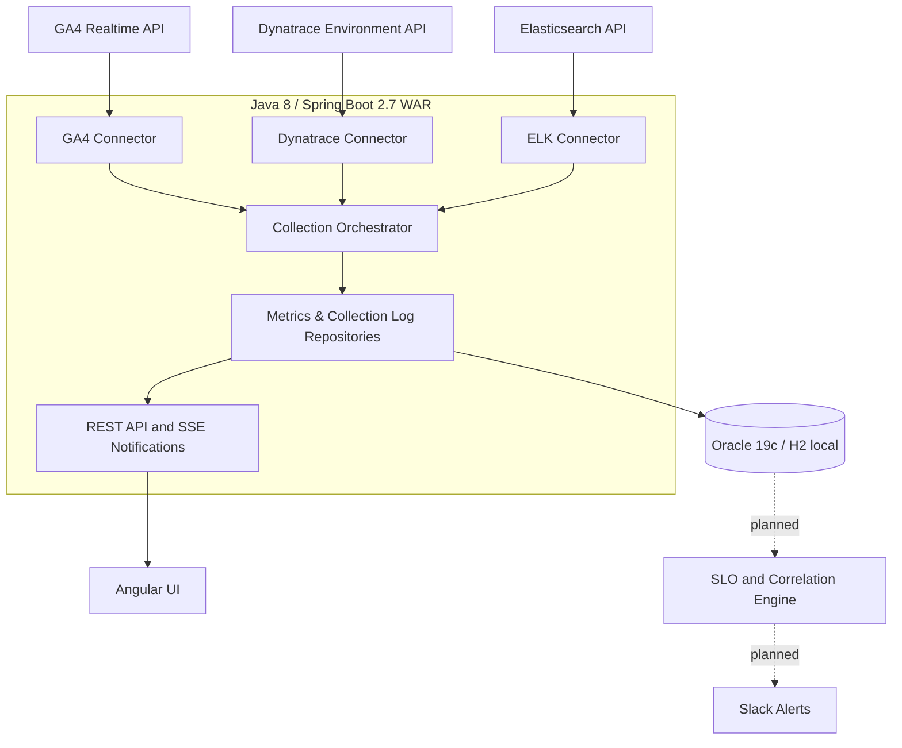
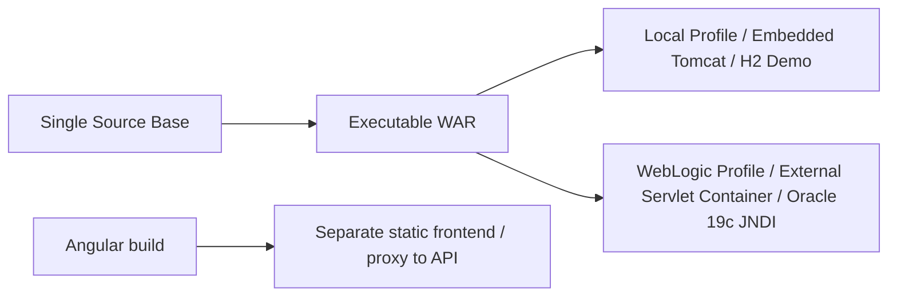

# Proposed System Architecture (MVP + planned phases)

## Deploy variants

## Code ownership
- `connector`: external API access and vendor-specific parsing.
- `domain`: normalized immutable-by-convention metric snapshots.
- `service`: per-source orchestration, failure isolation, structured collection logs, SSE.
- `persistence`: prepared SQL and Oracle/H2 storage.
- `api`: simple read-only dashboard API.
- `config`: environment-specific HTTP clients and application configuration.

## Clearly separated future modules
- `correlation`: match shared service, time and platform with explicit confidence.
- `slo`: SLI definitions, rolling evaluation, burn rate and error budget.
- `alerting`: deduplication, recovery, rate-limiting and Slack delivery.
- `security`: SSO, viewer/operator/admin permissions, auditing changes.

The architecture does **not** claim these future modules are already implemented. All source APIs need credentials, validation and testing in your network.
